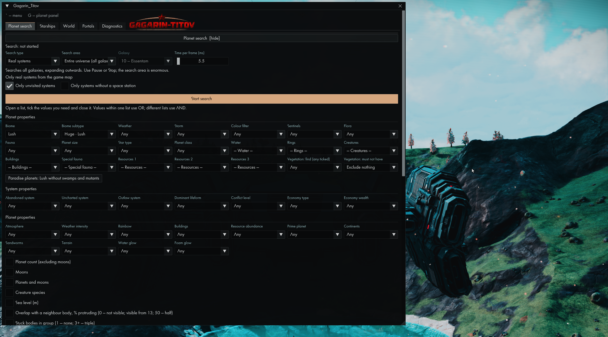
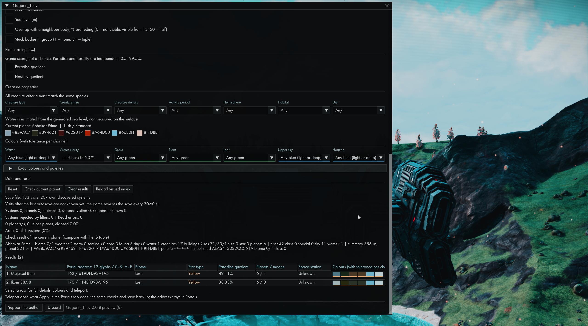
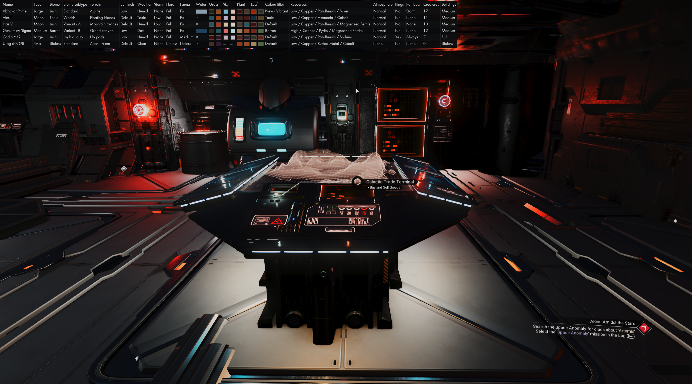
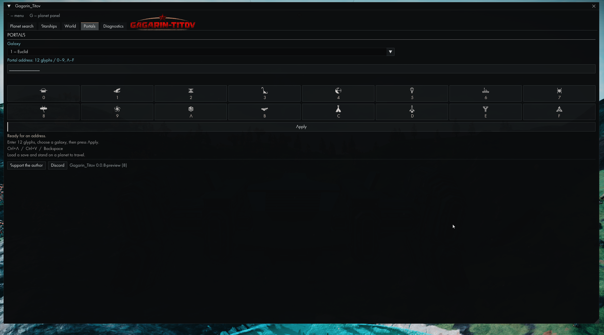
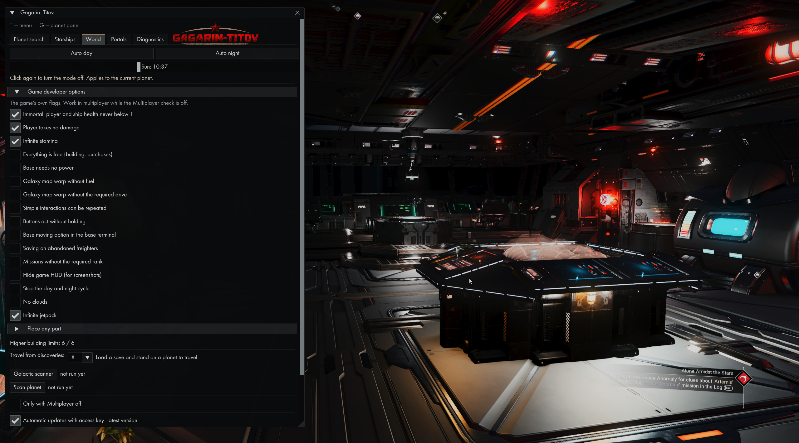
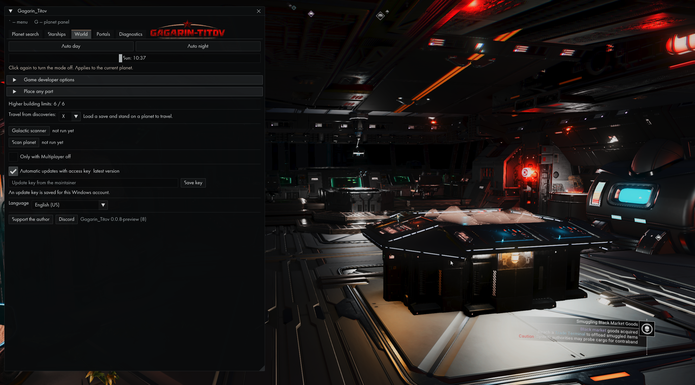
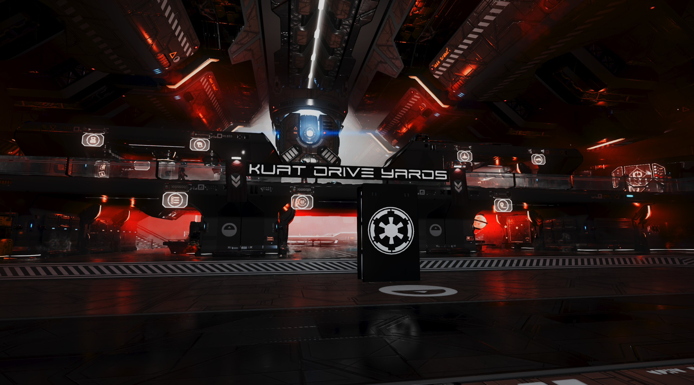

# GAGARIN-TITOV

**A No Man's Sky mod with an in-game menu** for searching planets and ships across the galaxy, teleporting by address, placing any part anywhere, and changing the game's developer options. The interface is available in all 17 game languages. Free.

English · [Русский](README.ru.md)

**Mod version:** 0.0.9 · **Game version:** No Man's Sky Forsaken 7.13 · engine 4233 · Steam build 26386568 (Windows)

## Screenshots

All eight screenshots were captured in No Man’s Sky with the 0.0.8 preview. The released version uses the same interface. Click an image to view it at full size.

### Planet search

Search real systems across all galaxies, with filters for biome, weather, resources, vegetation and system properties.



### Colours, creatures and search results

Filter water, grass, plants and sky colours, refine creature properties, and inspect results with portal addresses and paradise ratings.



### Planet panel

The G-key overlay compares planets at a glance: biomes, terrain, weather, resources, colours, fauna and buildings.



### Starships and Sentinel interceptors

Find nearby crash sites or search the galaxy for interceptors, with seed, colour, hull-pattern and ship-part filters.


### Portal travel

Choose a galaxy and enter a 12-glyph portal address using the glyph buttons or hexadecimal input.



### World and developer options

Day/night controls and game options, including infinite stamina and jetpack; the building-limit status shows all six patches applied.



### Scanner, updates and language

World-tab controls for discovery travel, galactic and planet scanning, private automatic updates, and interface language.



### Kuat Drive Yards — in-game showcase

A wide view of the Kuat Drive Yards interior, with the menu hidden.



## What's new in 0.0.9

- **Forsaken 7.13 compatibility:** updated for engine 4233 / Steam build 26386568, with exact executable checks.
- **Updated runtime integration:** refreshed searches, scanner/discoveries travel, teleporting, developer options/jetpack, day/night controls, building and navigation helpers.
- **Startup fix:** corrected the resource-hook instruction boundary and added build-time checks for all seven release detour prefixes.
- The maintainer confirmed the corrected preview works in game. The existing interface, saved settings, screenshots and private update keys are preserved.

## What's new in 0.0.8

- **Forsaken 7.11 compatibility:** updated for engine 4231 / Steam build 26295378, with checks against the exact game executable.
- **Updated game features:** refreshed hooks and layouts for searches, discoveries/scanner, teleporting, developer options/jetpack, building controls and limits, and navigation helpers.
- **New Builder-inspired interface:** charcoal panels, white text, flat controls, thin borders and restrained gold highlights. Existing menu structure and all 17 languages remain available.
- The maintainer confirmed the installed preview works in game and approved the new appearance. Private updates and saved settings remain supported.

## What's new in 0.0.7

- **Private automatic updates:** approved moderators receive an individual update key. Updates come from the protected update service; GitHub access is not required to use the mod or receive updates.
- **One-time setup:** install this ZIP manually, open **World**, paste your moderator key into **Update key from the maintainer**, click **Save key**, enable **Automatic updates with access key**, and restart the game.
- Keys are saved for your Windows account in Windows Credential Manager. No key is included in this ZIP or saved in the game's settings file.
- The updater verifies the download size and SHA-256 and applies the update on the next game launch. Missing/revoked keys or service outages leave the installed mod working.
- The private update download/restart cycle passed the maintainer's in-game test. Universe search, infinite jetpack and input fixes are included.

**Upgrading from 0.0.6 or earlier:** install this ZIP once and enter your own moderator key. Those versions cannot use the private update service. Do not share your key; request access from the maintainer through the Discord contact below.

## What's new in 0.0.6

- **Entire universe (all galaxies):** select the new option under **Planet search → Search area** to search across all supported galaxies, expanding outwards while keeping your filters.
- The **Galaxy** selector is greyed out and inaccessible in this mode; switching back preserves your previous galaxy choice.
- Results include galaxy information. Existing time per frame, Pause, Resume and Stop controls remain available. This search area is enormous; a complete scan is not practical.
- The universe-search preview passed the maintainer's in-game test.

**Private repository:** GitHub downloads require repository access. The maintainer can send the ZIP directly; moderators do not need GitHub accounts. Version 0.0.7 onward uses the protected update service with individual moderator keys.

## What's new in 0.0.5

- **English (US) by default:** fresh installations open the in-game menu in English (US). Saved language selections are preserved.
- To change an existing installation, select **English (US)** in the **Language** list at the bottom of the menu.

## What's new in 0.0.4

- **Infinite jetpack:** enable it under **World → Game developer options** to keep jetpack fuel from running out. Turn it off to resume normal fuel use. This is separate from Infinite stamina.
- **Optional multiplayer check:** Infinite jetpack follows **Only with Multiplayer off**. Leave that checkbox unchecked to use it with multiplayer enabled.
- **Updates from this repository:** version 0.0.4 onward checks **ThePrecisionTechnician/Gagarin-Titov** for updates.
- The tested menu mouse and keyboard fixes from 0.0.3 are included.

**Upgrading from 0.0.3 or earlier:** install the current ZIP once using the steps below. Older versions check the former repository and cannot switch update sources automatically. Your existing settings stay in place.

## What's new in 0.0.3

- **Mouse and keyboard handling in the menu.** Fixed the cursor snapping to the center during flight and accidental keyboard input into menu fields.

## What's new in 0.0.2

- **Menu and warp on NVIDIA graphics cards.** On some NVIDIA/DLSS systems, the menu would not open with `Ё`/`~` and warp would not activate with `X`; both now work.
- **Keys are hooked as soon as the game starts**, independently of the menu, so warp from the Discoveries menu works reliably.
- Shorter logs that focus on the information needed to diagnose problems.

## Download and install

**Download one file:** **`Gagarin-Titov_0.0.9.zip`** from the [**Releases**](../../releases/latest) page, in the release's **Assets** section. The “Source code” files are not the mod; GitHub adds them automatically.

**The archive contains:**

```
Gagarin-Titov_0.0.9.zip
├── Binaries\winmm.dll          ← the mod (one file)
├── GAMEDATA\Gagarin\           ← ship catalog and part icons for the menu
└── Gagarin-Titov\              ← this guide and font license (not needed by the game)
```

**Install in 5 steps:**

1. **Close the game.**
2. **Open the game folder:** in Steam, go to Library → right-click **No Man's Sky** → **Manage** → **Browse local files**. The folder usually looks like `C:\Program Files (x86)\Steam\steamapps\common\No Man's Sky\` and contains `Binaries` and `GAMEDATA`.
3. **Open** `Gagarin-Titov_0.0.9.zip`, select everything inside (`Binaries`, `GAMEDATA`, and `Gagarin-Titov`), and **drag it into the No Man's Sky folder** from step 2—the folder that contains `Binaries` and `GAMEDATA`.
   - Do not copy the files *inside* `Binaries` or `GAMEDATA`; copy the three folders into the main `No Man's Sky` folder.
   - If Windows asks whether to merge folders or replace files, choose **Yes/Replace**. The game's own files are not changed; this only adds the mod files.

   The result should look like this:

   ```
   No Man's Sky\                       ← copy the folders here
   ├── Binaries\
   │   ├── NMS.exe                     (already part of the game)
   │   └── winmm.dll                   ← mod file
   ├── GAMEDATA\
   │   ├── PCBANKS\                    (already part of the game)
   │   └── Gagarin\                    ← mod data
   │       ├── ships\catalog.txt, icons.bin
   │       └── parts\icons.bin
   └── Gagarin-Titov\                  ← guide; can be deleted
   ```
4. **Check:** `winmm.dll` is in `No Man's Sky\Binaries\`, next to `NMS.exe`.
5. **Start the game**, load a save, and press **`Ё`** (or `~` on an English keyboard) to open **Gagarin-Titov**. Press **`G`** for the planet table.

**Uninstall:** delete `No Man's Sky\Binaries\winmm.dll`. You can also delete `GAMEDATA\Gagarin`, which contains the mod's settings and logs. The game and saves are not changed.

---

## Features

Open the menu with **`Ё`** (`~`); open the current system's planet table with **`G`**.

### Planet search

- Searches systems across the galaxy with **the game's own procedural generator**—without flying or loading worlds.
- Filters include biome and subtype, weather and storms, Sentinels, water and clarity, flora and fauna, resources, Paradise planets, planet size, rings, star type, economy, race and conflict level, creature conditions, and vegetation (trees, mushrooms, cacti, corals, and more).
- Filter water, grass, plant, leaf, and sky colors by groups (blue, green, light, dark, etc.) or an exact sample.
- Search the current system, nearby space, or the whole galaxy. Results are saved, and you can teleport to any planet with one click.
- A summary explains why planets were rejected and which filter ruled out the most.

### Starships

- Search ships by parts and colors: fighters, haulers, shuttles, explorers, exotics, living ships, solar ships, Sentinel interceptors, and freighters.
- **Build a ship from parts:** choose a variant for each part and see the ship update on screen. The assembled ship becomes the search query. Rotate it with the mouse or use preset views.
- **Find seeds by appearance** across all CPU cores; see how rare the selected appearance is.
- **Crashed Sentinel interceptors across the galaxy:** find one and teleport to its crash site.
- **“On this planet”:** travel to the nearest crashed ship, freighter, interceptor, swarm, or portal.

### World

- **Time of day:** Auto day and Auto night.
- **Game developer options** can be toggled with checkboxes:
  - Immortality; no player damage; infinite stamina; infinite jetpack.
  - Everything is free (building and purchases); bases do not need power.
  - Galaxy map warps without fuel or the required drive.
  - Repeat simple interactions; buttons work without being held.
  - Move bases from the base terminal; save on derelict freighters; missions without the required rank.
  - Reveal the system map; remove clouds; stop the day/night cycle; hide the game HUD for screenshots.
- **Place any part:** use parts missing from the normal build menu, including station, freighter, Corvette, and hidden parts. Browse an illustrated catalog or search by name. Hidden parts can also be shown in the game's build menu.
- **Part scaling:** place parts at any size.
- **Remove placement restrictions:** including “Too close to ship” and the portal converter.
- **All parts everywhere:** base, Corvette, freighter, and station.
- **Higher building limits.**
- **Warp from Discoveries:** a “Teleport” row appears on a planet's Discoveries page. Use `X` (rebindable) or `Y` on a gamepad.
- **Galactic scanner** reveals all planets in the current system. **Scan planet** reveals nearby plants, minerals, and animals and grants the same reward as a visor scan.
- **Menu language:** English (US) by default; choose any of the game's 17 languages. Changes apply immediately and your selection is saved.

### Portals

Enter 12 glyphs, choose a galaxy by number or name, select **Apply**, and travel to the destination.

### Planet table (`G`)

A bar at the top of the screen shows every planet in the system: name, biome, weather, Sentinels, water, resources, color samples, and sky colors by day, dusk, and night.

---

## Important information

### Performance and slowdowns

The mod runs inside the game and shares the CPU with it. Its impact—from a fraction of a second to more—**depends on your computer**. Planet searches, ship seed searches (which use all CPU cores), and scanners are the heaviest tasks. While they run, the game **may slow down**, with lower frame rates or stutters. When a search finishes or you press **Stop**, performance returns to normal. On slower computers, search a smaller area (the current system or nearby space) instead of the whole galaxy.

Planet search has a **Time per frame (ms)** slider that controls how much of each game frame is given to the search (0.25–150 ms; default 2). Higher values make searches faster but can slow the game more; lower values keep the game smoother but take longer. If the game stutters, lower the value.

### Saves

**Place any part**, **All parts everywhere**, and **Remove placement restrictions** change what the game writes to your save. **Back up your save folder before trying them:**

```
%APPDATA%\HelloGames\NMS
```

It is your playtime—keeping an extra copy is a good idea.

### Multiplayer

By default, features also work in multiplayer. The **Only with Multiplayer off** checkbox on the World tab disables game-changing features while Multiplayer is on. Please be considerate of other players.

### Game updates

The mod is tied to a game version. After No Man's Sky updates, it checks `NMS.exe` and **does not activate** if the version is unsupported; the game itself continues to work normally. A mod update for the new game version will be published here.

### Auto-update

Version 0.0.7 onward checks the protected update service at game startup using your individual moderator key. Enter the key once on the **World** tab and click **Save key**, then restart. Keep **Automatic updates with access key** enabled to receive future updates.

The key is stored in Windows Credential Manager for your Windows account on this computer. Downloads stay on the fixed HTTPS update service; redirects are rejected. The DLL's size and SHA-256 are checked before replacement. The new version loads on the next game launch.

If the key is unavailable or revoked, contact the maintainer. Update access can be revoked without disabling the mod version you already have. The owner can see requests made with each assigned key; a request is not proof that an update was installed.

Versions 0.0.6 and earlier need a one-time manual upgrade to 0.0.7. A GitHub login cannot authenticate those older updaters to the private repository.

### Antivirus warnings

The game loads the mod as a DLL. Some antivirus programs flag files loaded this way by mods. To verify that your download matches the published file, check its checksum.

---

## Verify the file

Checksums for all files are in `SHA256SUMS.txt`. To check your copy in PowerShell:

```powershell
Get-FileHash "C:\Program Files (x86)\Steam\steamapps\common\No Man's Sky\Binaries\winmm.dll" -Algorithm SHA256
```

The result should match the `winmm.dll` line in `SHA256SUMS.txt`.

---

## How it works

When the game starts, it loads `winmm.dll`. Gagarin-Titov forwards all 181 functions to the system `winmm.dll` in `Windows\System32` without changing them—so game audio and timers work as usual—and starts the menu on a separate thread.

- Settings: `No Man's Sky\GAMEDATA\Gagarin\settings.txt`
- Logs: `No Man's Sky\GAMEDATA\Gagarin\logs\`

---

## Need help?

Tell me what you did, what you expected, and what happened. The game version, menu language, and latest log from `GAMEDATA\Gagarin\logs\` are helpful.

- Discord: [ThePrecisionTechnician](https://discord.com/users/262494560545013762)
- GitHub: [ThePrecisionTechnician](https://github.com/ThePrecisionTechnician)

The in-game menu also has **Support** and **Discord** buttons at the bottom.

**Support the project:** [Patreon](https://www.patreon.com/cw/ThePrecisionTechnician)

---

GAGARIN TITOV was created by **autoeme** and was passed on and is now maintained by **ThePrecisionTechnician**.

No Man's Sky, its assets, names, and font belong to Hello Games. The mod displays and uses data already present in your copy of the game.
